<!-- Language Switcher -->

  
  

<!-- Animated Hero Banner (Dark / Light Adaptive) -->
<picture>
  <source media="(prefers-color-scheme: dark)" srcset="./assets/readme/hero-banner.svg" />
  <source media="(prefers-color-scheme: light)" srcset="./assets/readme/hero-banner-light.svg" />
  
</picture>

<!-- Kinetic Typing Animation -->

  

<!-- Primary Telemetry & Contact Badges -->
<!-- TODO: Update portfolio link below once the portfolio site is deployed (or if switched to a custom domain) -->

  
  
  
  
  
  

<picture>
  <source media="(prefers-color-scheme: dark)" srcset="./assets/readme/divider-pulse.svg" />
  <source media="(prefers-color-scheme: light)" srcset="./assets/readme/divider-pulse-light.svg" />
  
</picture>

## 🎮 Operator Profile // Character Sheet

  

 

<table>
  <tr>
    <td width="50%" valign="top">
      <h3>🧭 Mission &amp; Engineering Focus</h3>
      

        I design and ship <strong>end-to-end software systems</strong> where backend correctness, domain modeling, and polished user interfaces meet. My work centers on <strong>multi-tenant SaaS platforms</strong>, <strong>resilient payment &amp; fiscal pipelines</strong>, <strong>offline-first commercial tools</strong>, and <strong>local-first AI agent systems</strong>.
      

      

        Previously built internal process-automation systems for <strong>Arcaika Engenharia</strong> — delivering a request-management backend and web frontend, a dedicated client portal, and an Android APK to streamline operational workflows.
      

    </td>
    <td width="50%" valign="top">
      <h3>⚡ Active Specializations</h3>
      <ul>
        <li><strong>Backend &amp; Domain Modeling:</strong> Clean Architecture, DDD, async Python (<code>FastAPI</code>, <code>SQLAlchemy 2</code>, <code>ARQ</code>), structured logging.</li>
        <li><strong>Revenue &amp; Fiscal Infrastructure:</strong> Idempotent <code>Stripe</code> &amp; <code>Mercado Pago</code> webhooks, dynamic Pix QR over <code>SSE</code>, automated <code>NFC-e</code> invoicing.</li>
        <li><strong>Local-First AI &amp; Desktop:</strong> Multi-agent trees, <code>MCP</code> servers, realtime voice companions, local cosine <code>RAG</code>, <code>Electron</code> + <code>SQLite</code>.</li>
        <li><strong>Production Ownership:</strong> <code>Docker Compose</code>, <code>Caddy</code> auto-TLS on Linux VPS, <code>GitHub Actions</code> CI/CD, and real-container integration suites.</li>
      </ul>
    </td>
  </tr>
</table>

<picture>
  <source media="(prefers-color-scheme: dark)" srcset="./assets/readme/divider-pulse.svg" />
  <source media="(prefers-color-scheme: light)" srcset="./assets/readme/divider-pulse-light.svg" />
  
</picture>

## 🧰 Equipped Arsenal // Tech Stack

<table>
  <thead>
    <tr>
      <th align="left">Domain</th>
      <th align="center">Core Icons</th>
      <th align="left">Frameworks, Libraries &amp; Ecosystem Tools</th>
    </tr>
  </thead>
  <tbody>
    <tr>
      <td><strong>💻 Languages</strong></td>
      <td align="center">
        
      </td>
      <td>
        
        
        
        
      </td>
    </tr>
    <tr>
      <td><strong>⚙️ Backend &amp; APIs</strong></td>
      <td align="center">
        
      </td>
      <td>
        
        
        
        
        
        
        
        
        
        
      </td>
    </tr>
    <tr>
      <td><strong>🎨 Frontend &amp; 3D</strong></td>
      <td align="center">
        
      </td>
      <td>
        
        
        
        
        
        
        
        
        
        
      </td>
    </tr>
    <tr>
      <td><strong>🧠 Desktop &amp; AI</strong></td>
      <td align="center">
        
      </td>
      <td>
        
        
        
        
        
        
        
      </td>
    </tr>
    <tr>
      <td><strong>🗄️ Data &amp; Storage</strong></td>
      <td align="center">
        
      </td>
      <td>
        
        
        
        
        
        
        
      </td>
    </tr>
    <tr>
      <td><strong>☁️ Infra &amp; DevOps</strong></td>
      <td align="center">
        
      </td>
      <td>
        
        
        
        
        
        
        
      </td>
    </tr>
    <tr>
      <td><strong>🛡️ Quality &amp; QA</strong></td>
      <td align="center">
        
      </td>
      <td>
        
        
        
        
        
        
        
      </td>
    </tr>
  </tbody>
</table>

<picture>
  <source media="(prefers-color-scheme: dark)" srcset="./assets/readme/divider-pulse.svg" />
  <source media="(prefers-color-scheme: light)" srcset="./assets/readme/divider-pulse-light.svg" />
  
</picture>

## 🚀 Flagship Systems // Featured Projects

<!-- FLAGSHIP 1: ORIN -->
<table>
  <tr>
    <td>
      
        
      

        <strong>🎙️ Orin (<code>v0.12.8</code>)</strong> is an open-source, local-first AI agent workspace for <strong>Windows &amp; Linux</strong> that unifies a Web UI, an <strong>Electron 37</strong> desktop app, and the <code>orin code</code> terminal CLI atop a single durable engine.
      

      <ul>
        <li><strong>Realtime PT-BR Voice Companion:</strong> Always-ready <code>LIVE</code> voice mode with custom <code>"Orin"</code> wake word, instant barge-in interruption, <code>SOUL.md</code> persona identity, and persistent affective memory.</li>
        <li><strong>Hierarchical Multi-Agent Trees:</strong> Delegate complex workflows across a tree of specialist sub-agents — each bound to your chosen model/provider and orchestrating subscriptions you already own (<strong>Claude, Codex, Antigravity</strong>).</li>
        <li><strong>Orin Code Engineering Bench:</strong> Integrated live app preview, file &amp; diff inspector, embedded terminal, "Time Machine" checkpoints, and capability parity with <code>claude-agent-sdk</code>.</li>
        <li><strong>Extensible Local Engine:</strong> Native <code>MCP</code> server integration, plugin &amp; procedural skill system, local <code>NumPy</code> cosine-similarity RAG index, and zero-cloud-lock-in <code>SQLite</code> storage.</li>
      </ul>
      

        
        
        
        
        
        
        
      

      

        
      

    </td>
  </tr>
</table>

 

<!-- FLAGSHIP 2: AURYLY -->
<table>
  <tr>
    <td>
      
        
      

        <strong>🧠 Auryly</strong> is a full-stack platform to learn Artificial Intelligence through <strong>guided tracks, hands-on coding labs, and gamified progression</strong>, engineered inside a strict <strong>Clean Architecture / DDD</strong> monorepo with integrated growth and commerce engines.
      

      <ul>
        <li><strong>Interactive Learning &amp; Gamification:</strong> Structured AI skill paths, browser-based hands-on projects powered by <code>CodeMirror</code>, Web Push engagement notifications, and full internationalization via <code>Lingui</code>.</li>
        <li><strong>Built-In Growth &amp; Billing Engine:</strong> Lead capture flows, admin + public sales funnels, interactive choice pages, <code>Stripe</code> checkout &amp; webhook processing, and an exportable <code>CVA</code> + <code>Tailwind CSS 4</code> design system.</li>
        <li><strong>Analytical &amp; Async Backbone:</strong> Background job queues via <code>Redis 7</code> + <code>ARQ</code> workers, embedded OLAP telemetry with <code>DuckDB</code> + <code>PyArrow</code>, and <code>Argon2id</code> + <code>PyJWT</code> security.</li>
        <li><strong>Production Rigor:</strong> Containerized with <code>Docker Compose</code>, <code>Caddy</code> (auto TLS), <code>PostgreSQL 16</code>, and S3-compatible <code>Garage</code> storage; enforced by <code>pytest + testcontainers</code>, <code>import-linter</code>, <code>mypy</code>, <code>ruff</code>, and <code>GitHub Actions</code> CI/CD.</li>
      </ul>
      

        
        
        
        
        
        
        
      

      

        
      

    </td>
  </tr>
</table>

 

<!-- FLAGSHIP 3: MARKETFY -->
<table>
  <tr>
    <td>
      
        
      

        <strong>🛒 Marketfy (SGM Marketfy)</strong> is a multi-tenant SaaS for <strong>grocery-store ERP management and Point of Sale (POS)</strong>, built for uninterrupted checkout operations, Brazilian fiscal compliance, and realtime instant payments.
      

      <ul>
        <li><strong>Offline-First POS Checkout:</strong> Powered by <code>IndexedDB / Dexie</code> with background synchronization so cashiers continue scanning and selling seamlessly through internet outages.</li>
        <li><strong>NFC-e Fiscal Invoicing:</strong> Integrated with its own dedicated fiscal service (<strong>Neectify Fiscal</strong>) supporting per-product tax rules, fiscal validation, and approval workflows.</li>
        <li><strong>Realtime Pix &amp; Reconciliation:</strong> Dynamic in-store Pix QR generation via <code>Mercado Pago</code> with live payment confirmation streamed over <code>SSE</code>, webhook intake, automated reconciliation, and anomaly detection.</li>
        <li><strong>Commercial Operations &amp; Growth:</strong> Inventory tracking, customer credit ledger, <code>XLSX</code>/<code>PDF</code> financial reports (<code>pandas</code>, <code>fpdf2</code>), subscription paywall, 5-role RBAC (<code>admin</code>, <code>owner</code>, <code>manager</code>, <code>accountant</code>, <code>cashier</code>), and A/B sales funnels with sandboxed-iframe HTML steps, UTM attribution, and cohort metrics.</li>
      </ul>
      

        
        
        
        
        
        
      

      

        
        
      

    </td>
  </tr>
</table>

### 🧩 Ecosystem & Specialized Services

<table>
  <tr>
    <td width="50%" valign="top">
      <h4>💳 Billing Core</h4>
      

        Production-oriented <strong>FastAPI</strong> microservice handling recurring billing across multiple SaaS products in the Neectify ecosystem: subscription lifecycles, payment gateway adapters, idempotent webhook intake, async jobs with per-job traceability, rate limiting, structured logs, readiness probes, and deploy runbooks.
      

      

        
        
        
      

      

        
      

    </td>
    <td width="50%" valign="top">
      <h4>🎭 Ashy</h4>
      

        Local-first desktop virtual companion written in <strong>TypeScript</strong>: shared history, persistent 4-tier affect system, realtime omni voice (<code>LFM3-Omni</code>) with lip-sync on a <strong>Live2D Cubism 4</strong> stage, local <code>SQLite + FTS5</code> memory scheduled via <code>FSRS-6</code>, <code>AES-256-GCM</code> encryption, Playwright E2E tests, and zero telemetry.
      

      

        
        
        
      

      

        
      

    </td>
  </tr>
  <tr>
    <td width="50%" valign="top">
      <h4>🌐 Neectify &amp; Engify</h4>
      

        Multi-product SaaS ecosystem (<code>painel.neectify.com</code>): modern <strong>React 19 + TypeScript</strong> SPA deployed on Vercel with <code>MSW</code>, <code>Playwright</code>, and <code>oxlint</code>; paired with <strong>Engify</strong> — a Python backend + React/TS frontend engineered with <code>Radix UI</code>, <code>TanStack Query</code>, and <code>dnd-kit</code>.
      

      

        
        
        
      

      

        
      

    </td>
    <td width="50%" valign="top">
      <h4>🖥️ AgentDesk</h4>
      

        Windows local-first desktop workbench for creating, governing, and running autonomous AI agents safely: combines <strong>FastAPI</strong>, <strong>SQLite</strong>, <strong>React</strong>, and <strong>Electron</strong> with <code>Ollama</code>, <code>OpenRouter</code>, <code>MCP stdio</code> tool servers, human-in-the-loop approval gates, and structured audit logs.
      

      

        
        
        
      

      

        
      

    </td>
  </tr>
</table>

<picture>
  <source media="(prefers-color-scheme: dark)" srcset="./assets/readme/divider-pulse.svg" />
  <source media="(prefers-color-scheme: light)" srcset="./assets/readme/divider-pulse-light.svg" />
  
</picture>

## 🏛️ Architecture & Engineering Blueprint

Typical production topology across the multi-tenant SaaS platforms I architect and operate:

```mermaid
flowchart LR
    subgraph Clients["Client Surfaces"]
        SPA["React 19 + TS SPA\n(TanStack Query · i18n)"]
        POS["Offline-First POS\n(IndexedDB / Dexie Sync)"]
        DESK["Local-First Desktop\n(Electron · SQLite · MCP)"]
    end

    subgraph Edge["Edge & Ingress"]
        CADDY["Caddy Reverse Proxy\n(Auto TLS · Rate Limits)"]
    end

    subgraph Core["Clean Architecture / DDD Core"]
        API["FastAPI Async Engine\n(Pydantic v2 · Argon2id / JWT)"]
        SSE["Realtime SSE Hub\n(Live Pix & Agent Streams)"]
        WRK["ARQ Async Workers\n(Per-Job Traceability)"]
    end

    subgraph Data["Persistence & Analytics"]
        PG[("PostgreSQL 16\n(asyncpg · Alembic)")]
        REDIS[("Redis 7\n(Cache · Queue · Locks)")]
        S3[("S3 / Garage\n(Object Storage)")]
        DUCK[("DuckDB + PyArrow\n(Funnel & Cohort OLAP)")]
    end

    subgraph External["Gateways & Fiscal"]
        PAY["Stripe & Mercado Pago\n(Signed Webhooks · Pix QR)"]
        FISC["Neectify Fiscal\n(NFC-e Tax Rules)"]
    end

    SPA & POS --> CADDY
    DESK <--> API
    CADDY --> API
    CADDY --> SSE
    PAY -- "Idempotent Webhooks" --> CADDY
    API --> PG
    API --> REDIS
    REDIS --> WRK
    WRK --> PG
    WRK --> S3
    WRK --> DUCK
    WRK --> FISC
    WRK --> SSE
```

  
<strong>🧱 1. Clean Architecture &amp; Enforced DDD Boundaries</strong>

   
  Domain entities, value objects, and application use-cases stay decoupled from HTTP frameworks, ORMs, and external gateways. In monorepos like <strong>Auryly</strong>, architectural boundaries are mechanically enforced in CI via <code>import-linter</code> alongside strict <code>mypy</code> and <code>Pydantic v2</code> contracts so domain logic never leaks into infrastructure adapters.

  
<strong>⚡ 2. Async-First Python &amp; Traceable Background Workers</strong>

   
  High-concurrency I/O paths run end-to-end on <code>FastAPI</code> + <code>SQLAlchemy 2 (async)</code> + <code>asyncpg</code>. Long-running or retry-sensitive work (webhook settlement, fiscal emission, report generation, Web Push) is offloaded to <code>Redis</code> + <code>ARQ</code> workers with per-job correlation IDs and structured <code>structlog</code> telemetry.

  
<strong>📴 3. Offline-First Commercial Resilience</strong>

   
  Retail checkouts cannot freeze when ISP links drop. In <strong>Marketfy</strong>, catalog state, tax rules, and pending sales live locally in <code>IndexedDB / Dexie</code> with deterministic background sync and reconciliation once connectivity returns. On desktop (<strong>Orin</strong>, <strong>Ashy</strong>, <strong>AgentDesk</strong>), <code>SQLite (+FTS5)</code> keeps user state instant and self-contained.

  
<strong>💳 4. Idempotent Billing, Realtime Pix &amp; Fiscal Automation</strong>

   
  Financial flows across <strong>Billing Core</strong>, <strong>Auryly</strong>, and <strong>Marketfy</strong> treat every webhook as potentially duplicated or out-of-order: cryptographic signature verification, idempotency keys, state-machine transitions, automated reconciliation, anomaly detection, realtime <code>SSE</code> checkout updates for <code>Mercado Pago</code> Pix QR, and rule-driven <code>NFC-e</code> invoicing.

  
<strong>🧠 5. Local-First Multi-Agent Orchestration &amp; MCP</strong>

   
  Rather than thin prompt wrappers, I build durable agent runtimes: hierarchical trees of specialist agents across <strong>Claude, Codex, Gemini, OpenRouter, and Ollama</strong>, standardized tool discovery via <strong>Model Context Protocol (MCP)</strong>, human approval gates, audit logs, local vector retrieval, and low-latency voice interaction with barge-in support.

  
<strong>🧪 6. Testing Pyramid &amp; Self-Hosted Production Ops</strong>

   
  Confidence comes from realistic automated checks: backend integration suites using <code>pytest + testcontainers</code> against real PostgreSQL and Redis instances, frontend behavior tests with <code>Vitest + Testing Library + MSW</code>, full browser journeys in <code>Playwright</code>, and reproducible deployments on Linux VPS hosts via <code>Docker Compose</code>, <code>Caddy</code>, readiness checks, and operational runbooks.

<picture>
  <source media="(prefers-color-scheme: dark)" srcset="./assets/readme/divider-pulse.svg" />
  <source media="(prefers-color-scheme: light)" srcset="./assets/readme/divider-pulse-light.svg" />
  
</picture>

## 🏆 Unlocked Achievements // Engineering Quests

<table>
  <tr>
    <td width="33%" valign="top">
      <strong>🏆 Unified Agent Engine</strong> 
      Shipped <strong>Orin (v0.12.8)</strong> combining Web UI, Electron desktop, realtime PT-BR voice, and <code>orin code</code> CLI on one local-first engine.
    </td>
    <td width="33%" valign="top">
      <strong>💳 Idempotent Billing Core</strong> 
      Engineered multi-SaaS subscription billing, Stripe funnels, and dynamic Mercado Pago Pix QR with live SSE confirmation.
    </td>
    <td width="33%" valign="top">
      <strong>🧾 Fiscal NFC-e Pipeline</strong> 
      Integrated Brazilian NFC-e fiscal invoicing (<strong>Neectify Fiscal</strong>) with per-product tax rules and approval workflows.
    </td>
  </tr>
  <tr>
    <td width="33%" valign="top">
      <strong>📴 Offline-First POS</strong> 
      Built an IndexedDB/Dexie grocery POS with resilient background sync, credit ledger, and automated payment reconciliation.
    </td>
    <td width="33%" valign="top">
      <strong>🎭 Zero-Telemetry Companion</strong> 
      Created <strong>Ashy</strong> featuring Live2D Cubism 4 lip-sync, 4-tier affect, FSRS-6 memory in SQLite FTS5, and AES-256-GCM encryption.
    </td>
    <td width="33%" valign="top">
      <strong>⚙️ Field Process Automation</strong> 
      Delivered internal request-management APIs, web portal, and Android APK automating workflows at <strong>Arcaika Engenharia</strong>.
    </td>
  </tr>
</table>

<picture>
  <source media="(prefers-color-scheme: dark)" srcset="./assets/readme/divider-pulse.svg" />
  <source media="(prefers-color-scheme: light)" srcset="./assets/readme/divider-pulse-light.svg" />
  
</picture>

## 📊 Telemetry // GitHub Activity & Metrics

<!-- Note: Upstream shared instances github-readme-stats.vercel.app (HTTP 503) and github-readme-activity-graph.vercel.app (HTTP 402) are currently rate-limited/paused on Vercel; active community mirrors of the exact same open-source services are used below so cards render reliably. Swap to a self-hosted Vercel URL anytime. -->

  <picture>
    <source media="(prefers-color-scheme: dark)" srcset="https://github-readme-streak-stats.herokuapp.com/?user=carlos-edu2367&theme=dark&background=0A0507&border=4C0519&stroke=881337&ring=FF1F3D&fire=FF1F3D&currStreakLabel=FDA4AF&sideLabels=FDA4AF&currStreakNum=FFF1F2&sideNums=FFF1F2&dates=9F1239" />
    <source media="(prefers-color-scheme: light)" srcset="https://github-readme-streak-stats.herokuapp.com/?user=carlos-edu2367&theme=default&background=FFFBFB&border=FDA4AF&stroke=FECDD3&ring=E11D48&fire=FF1F3D&currStreakLabel=9F1239&sideLabels=9F1239&currStreakNum=1F0810&sideNums=1F0810&dates=881337" />
    
  </picture>
  &nbsp;
  <picture>
    <source media="(prefers-color-scheme: dark)" srcset="https://github-readme-stats-sigma-five.vercel.app/api/top-langs/?username=carlos-edu2367&layout=compact&langs_count=8&theme=dark&bg_color=0a0507&title_color=ff1f3d&text_color=fff1f2&border_color=4c0519" />
    <source media="(prefers-color-scheme: light)" srcset="https://github-readme-stats-sigma-five.vercel.app/api/top-langs/?username=carlos-edu2367&layout=compact&langs_count=8&theme=default&bg_color=fffbfb&title_color=be123c&text_color=1f0810&border_color=fda4af" />
    
  </picture>

  <picture>
    <source media="(prefers-color-scheme: dark)" srcset="https://github-readme-activity-graph-ochre.vercel.app/graph?username=carlos-edu2367&bg_color=0a0507&color=fda4af&line=ff1f3d&point=fff1f2&area=true&area_color=be123c&hide_border=false&border_color=4c0519" />
    <source media="(prefers-color-scheme: light)" srcset="https://github-readme-activity-graph-ochre.vercel.app/graph?username=carlos-edu2367&bg_color=fffbfb&color=881337&line=e11d48&point=be123c&area=true&area_color=fda4af&hide_border=false&border_color=fda4af" />
    
  </picture>

<picture>
  <source media="(prefers-color-scheme: dark)" srcset="./assets/readme/divider-pulse.svg" />
  <source media="(prefers-color-scheme: light)" srcset="./assets/readme/divider-pulse-light.svg" />
  
</picture>

## 🔭 Current Quest Log // Now

- 🎓 Finishing my **Systems Analysis & Development (ADS)** degree *(completing in 2026)*.
- 🤖 Expanding local-first multi-agent orchestration, **MCP** tool ecosystems, and realtime voice UX in **Orin** and **Ashy**.
- 🏗️ Deepening distributed SaaS patterns, idempotent financial pipelines, and embedded OLAP analytics (`DuckDB` + `PyArrow`).
- 🌍 Continually sharpening technical & conversational **English (currently B2)** for international teams and clients.

<picture>
  <source media="(prefers-color-scheme: dark)" srcset="./assets/readme/divider-pulse.svg" />
  <source media="(prefers-color-scheme: light)" srcset="./assets/readme/divider-pulse-light.svg" />
  
</picture>

## 📡 Initiate Co-Op // Freelance & Contact

Need an engineer to **architect a multi-tenant SaaS**, **ship a resilient FastAPI + React product**, **integrate Stripe / Pix / fiscal pipelines**, or **build custom AI agent workflows & desktop tools**?

**I am currently available for freelance projects and technical consulting.**

<!-- TODO: Update portfolio URL below once deployed if custom domain changes -->

  
  
  

<picture>
  <source media="(prefers-color-scheme: dark)" srcset="./assets/readme/footer.svg" />
  <source media="(prefers-color-scheme: light)" srcset="./assets/readme/footer-light.svg" />
  
</picture>

