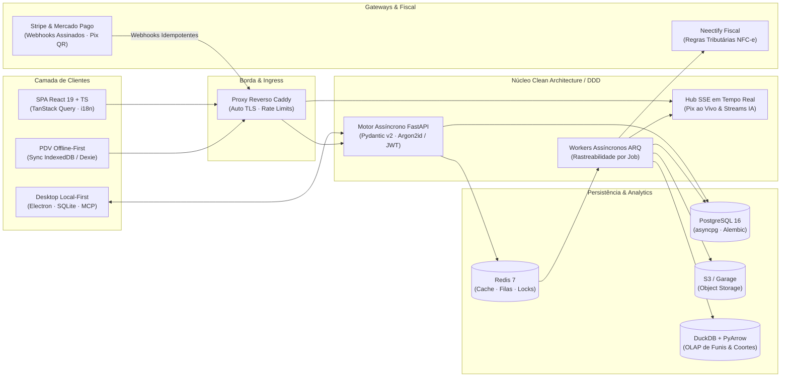

<!-- Seletor de Idioma -->

  
  

<!-- Banner Hero Animado (Adaptativo Dark / Light) -->
<picture>
  <source media="(prefers-color-scheme: dark)" srcset="./assets/readme/hero-banner.pt-BR.svg" />
  <source media="(prefers-color-scheme: light)" srcset="./assets/readme/hero-banner-light.pt-BR.svg" />
  
</picture>

<!-- Animação de Digitação -->

  

<!-- Badges de Telemetria & Contato -->
<!-- TODO: Atualizar o link do portfólio abaixo após o deploy do site (ou caso utilize domínio próprio) -->

  
  
  
  
  
  

<picture>
  <source media="(prefers-color-scheme: dark)" srcset="./assets/readme/divider-pulse.svg" />
  <source media="(prefers-color-scheme: light)" srcset="./assets/readme/divider-pulse-light.svg" />
  
</picture>

## 🎮 Perfil do Operador // Ficha de Personagem

  

 

<table>
  <tr>
    <td width="50%" valign="top">
      <h3>🧭 Missão &amp; Foco de Engenharia</h3>
      

        Projeto e entrego <strong>sistemas de software ponta a ponta</strong> nos quais consistência de backend, modelagem rica de domínio e interfaces refinadas convergem. Meu trabalho concentra-se em <strong>plataformas SaaS multi-tenant</strong>, <strong>motores resilientes de cobrança e mensageria fiscal</strong>, <strong>aplicações comerciais offline-first</strong> e <strong>sistemas local-first de agentes de IA</strong>.
      

      

        Desenvolvi sistemas internos de automação de processos para a <strong>Arcaika Engenharia</strong> — construindo backend e frontend web de gestão de solicitações, portal do cliente e aplicativo Android (APK) para otimização de fluxos operacionais.
      

    </td>
    <td width="50%" valign="top">
      <h3>⚡ Especializações Ativas</h3>
      <ul>
        <li><strong>Backend &amp; Modelagem de Domínio:</strong> Clean Architecture, DDD, Python assíncrono (<code>FastAPI</code>, <code>SQLAlchemy 2</code>, <code>ARQ</code>) e logs estruturados.</li>
        <li><strong>Infraestrutura Financeira &amp; Fiscal:</strong> Webhooks idempotentes para <code>Stripe</code> e <code>Mercado Pago</code>, QR Code Pix dinâmico via <code>SSE</code> e emissão automatizada de <code>NFC-e</code>.</li>
        <li><strong>IA Local-First &amp; Desktop:</strong> Árvores multi-agentes, servidores <code>MCP</code>, voz em tempo real, <code>RAG</code> local por similaridade de cosseno e <code>Electron</code> + <code>SQLite</code>.</li>
        <li><strong>Operação em Produção:</strong> <code>Docker Compose</code>, <code>Caddy</code> com TLS automático em VPS Linux, CI/CD com <code>GitHub Actions</code> e testes de integração com containers reais.</li>
      </ul>
    </td>
  </tr>
</table>

<picture>
  <source media="(prefers-color-scheme: dark)" srcset="./assets/readme/divider-pulse.svg" />
  <source media="(prefers-color-scheme: light)" srcset="./assets/readme/divider-pulse-light.svg" />
  
</picture>

## 🧰 Arsenal Equipado // Stack Tecnológica

<table>
  <thead>
    <tr>
      <th align="left">Domínio</th>
      <th align="center">Ícones Principais</th>
      <th align="left">Frameworks, Bibliotecas &amp; Ecossistema</th>
    </tr>
  </thead>
  <tbody>
    <tr>
      <td><strong>💻 Linguagens</strong></td>
      <td align="center">
        
      </td>
      <td>
        
        
        
        
      </td>
    </tr>
    <tr>
      <td><strong>⚙️ Backend &amp; APIs</strong></td>
      <td align="center">
        
      </td>
      <td>
        
        
        
        
        
        
        
        
        
        
      </td>
    </tr>
    <tr>
      <td><strong>🎨 Frontend &amp; 3D</strong></td>
      <td align="center">
        
      </td>
      <td>
        
        
        
        
        
        
        
        
        
        
      </td>
    </tr>
    <tr>
      <td><strong>🧠 Desktop &amp; IA</strong></td>
      <td align="center">
        
      </td>
      <td>
        
        
        
        
        
        
        
      </td>
    </tr>
    <tr>
      <td><strong>🗄️ Dados &amp; Storage</strong></td>
      <td align="center">
        
      </td>
      <td>
        
        
        
        
        
        
        
      </td>
    </tr>
    <tr>
      <td><strong>☁️ Infra &amp; DevOps</strong></td>
      <td align="center">
        
      </td>
      <td>
        
        
        
        
        
        
        
      </td>
    </tr>
    <tr>
      <td><strong>🛡️ Qualidade &amp; QA</strong></td>
      <td align="center">
        
      </td>
      <td>
        
        
        
        
        
        
        
      </td>
    </tr>
  </tbody>
</table>

<picture>
  <source media="(prefers-color-scheme: dark)" srcset="./assets/readme/divider-pulse.svg" />
  <source media="(prefers-color-scheme: light)" srcset="./assets/readme/divider-pulse-light.svg" />
  
</picture>

## 🚀 Sistemas Principais // Projetos em Destaque

<!-- DESTAQUE 1: ORIN -->
<table>
  <tr>
    <td>
      
        
      

        <strong>🎙️ Orin (<code>v0.12.8</code>)</strong> é um workspace local-first open-source de agentes de IA para <strong>Windows e Linux</strong> que unifica interface Web, aplicativo desktop em <strong>Electron 37</strong> e o terminal CLI <code>orin code</code> sobre um único motor durável.
      

      <ul>
        <li><strong>Companheiro de Voz PT-BR em Tempo Real:</strong> Modo <code>LIVE</code> com wake word <code>"Orin"</code>, interrupção instantânea (barge-in), identidade definida via <code>SOUL.md</code> e memória afetiva persistente.</li>
        <li><strong>Árvore Hierárquica de Agentes Especialistas:</strong> Orquestre times de subagentes em árvore — cada um vinculado ao provedor/modelo de sua escolha, aproveitando as assinaturas que você já possui (<strong>Claude, Codex, Antigravity</strong>).</li>
        <li><strong>Bancada de Engenharia Orin Code:</strong> Preview ao vivo integrado, inspetor de arquivos e diffs, terminal embutido, checkpoints "Time Machine" e paridade com o <code>claude-agent-sdk</code>.</li>
        <li><strong>Motor Local Extensível:</strong> Integração nativa com servidores <code>MCP</code>, sistema de plugins e skills procedurais, índice <code>RAG</code> local com cosseno via <code>NumPy</code> e persistência em <code>SQLite</code>.</li>
      </ul>
      

        
        
        
        
        
        
        
      

      

        
      

    </td>
  </tr>
</table>

 

<!-- DESTAQUE 2: AURYLY -->
<table>
  <tr>
    <td>
      
        
      

        <strong>🧠 Auryly</strong> é uma plataforma completa para aprendizado de Inteligência Artificial com <strong>trilhas guiadas, projetos práticos e gamificação</strong>, construída em um monorepo com <strong>Clean Architecture / DDD</strong> estrito e infraestrutura integrada de vendas e conversão.
      

      <ul>
        <li><strong>Aprendizado Interativo &amp; Gamificação:</strong> Trilhas estruturadas de IA, laboratórios práticos no navegador com <code>CodeMirror</code>, notificações Web Push e internacionalização completa via <code>Lingui</code>.</li>
        <li><strong>Motor Próprio de Funis &amp; Pagamentos:</strong> Captura de leads, funis de vendas públicos e administrativos, choice pages, pagamentos e webhooks <code>Stripe</code> e Design System exportável com <code>CVA</code> + <code>Tailwind CSS 4</code>.</li>
        <li><strong>Backbone Analítico &amp; Assíncrono:</strong> Processamento em background com <code>Redis 7</code> + workers <code>ARQ</code>, analytics embarcado com <code>DuckDB</code> + <code>PyArrow</code> e segurança com <code>Argon2id</code> + <code>PyJWT</code>.</li>
        <li><strong>Rigor de Produção:</strong> Orquestrado com <code>Docker Compose</code>, <code>Caddy</code> (TLS automático), <code>PostgreSQL 16</code> e storage S3 <code>Garage</code>; validado por <code>pytest + testcontainers</code>, <code>import-linter</code>, <code>mypy</code>, <code>ruff</code> e CI/CD no <code>GitHub Actions</code>.</li>
      </ul>
      

        
        
        
        
        
        
        
      

      

        
      

    </td>
  </tr>
</table>

 

<!-- DESTAQUE 3: MARKETFY -->
<table>
  <tr>
    <td>
      
        
      

        <strong>🛒 Marketfy (SGM Marketfy)</strong> é um SaaS multi-tenant para <strong>gestão de mercados e frente de caixa (PDV)</strong>, projetado para operação ininterrupta sem internet, conformidade fiscal brasileira e pagamentos instantâneos em tempo real.
      

      <ul>
        <li><strong>PDV Offline-First:</strong> Construído sobre <code>IndexedDB / Dexie</code> com sincronização em segundo plano para manter os caixas vendendo normalmente mesmo durante quedas de conexão.</li>
        <li><strong>Emissão Fiscal NFC-e:</strong> Integrado ao seu próprio serviço fiscal dedicado (<strong>Neectify Fiscal</strong>), com regras tributárias por produto e fluxo estruturado de aprovação.</li>
        <li><strong>Pix Dinâmico em Tempo Real &amp; Conciliação:</strong> Geração de QR Code Pix em loja via <code>Mercado Pago</code> com confirmação ao vivo transmitida por <code>SSE</code>, recepção de webhooks, conciliação automática e detecção de anomalias.</li>
        <li><strong>Gestão Comercial &amp; Growth:</strong> Controle de estoque, caderneta de crédito/fiado de clientes, relatórios financeiros em <code>XLSX</code>/<code>PDF</code> (<code>pandas</code>, <code>fpdf2</code>), billing de assinatura e paywall, controle multiusuário (<code>admin</code>, <code>owner</code>, <code>manager</code>, <code>accountant</code>, <code>cashier</code>) e funis de vendas com etapas HTML em iframe isolado, variantes A/B ponderadas, atribuição UTM e métricas de coorte.</li>
      </ul>
      

        
        
        
        
        
        
      

      

        
        
      

    </td>
  </tr>
</table>

### 🧩 Ecossistema & Serviços Especializados

<table>
  <tr>
    <td width="50%" valign="top">
      <h4>💳 Billing Core</h4>
      

        Serviço <strong>FastAPI</strong> orientado a produção para cobrança recorrente compartilhada entre múltiplos SaaS do ecossistema Neectify: assinaturas, integração com gateways, ingestão idempotente de webhooks, jobs assíncronos com rastreabilidade individual, rate limiting, logs estruturados, readiness checks e runbooks de deploy.
      

      

        
        
        
      

      

        
      

    </td>
    <td width="50%" valign="top">
      <h4>🎭 Ashy</h4>
      

        Companheira virtual local-first para desktop escrita em <strong>TypeScript</strong>: histórico compartilhado, afeto persistente em 4 níveis, voz omni em tempo real (<code>LFM3-Omni</code>) com lip-sync em palco <strong>Live2D Cubism 4</strong>, memória local <code>SQLite + FTS5</code> com repetição espaçada <code>FSRS-6</code>, criptografia <code>AES-256-GCM</code>, testes E2E Playwright e zero telemetria.
      

      

        
        
        
      

      

        
      

    </td>
  </tr>
  <tr>
    <td width="50%" valign="top">
      <h4>🌐 Neectify &amp; Engify</h4>
      

        Ecossistema SaaS multiproduto (<code>painel.neectify.com</code>): SPA moderna em <strong>React 19 + TypeScript</strong> hospedada na Vercel com <code>MSW</code>, <code>Playwright</code> e <code>oxlint</code>; integrada ao <strong>Engify</strong> — backend Python + frontend React/TS construído com <code>Radix UI</code>, <code>TanStack Query</code> e <code>dnd-kit</code>.
      

      

        
        
        
      

      

        
      

    </td>
    <td width="50%" valign="top">
      <h4>🖥️ AgentDesk</h4>
      

        Bancada desktop local-first para Windows voltada à criação e execução segura de agentes de IA: une <strong>FastAPI</strong>, <strong>SQLite</strong>, <strong>React</strong> e <strong>Electron</strong> com suporte a <code>Ollama</code>, <code>OpenRouter</code>, servidores de ferramentas <code>MCP stdio</code>, portões de aprovação humana e logs de auditoria.
      

      

        
        
        
      

      

        
      

    </td>
  </tr>
</table>

<picture>
  <source media="(prefers-color-scheme: dark)" srcset="./assets/readme/divider-pulse.svg" />
  <source media="(prefers-color-scheme: light)" srcset="./assets/readme/divider-pulse-light.svg" />
  
</picture>

## 🏛️ Arquitetura & Princípios de Engenharia

Topologia típica de produção nas plataformas SaaS multi-tenant que projeto e opero:

  
<strong>🧱 1. Clean Architecture &amp; Fronteiras DDD Verificadas em CI</strong>

   
  Entidades de domínio, objetos de valor e casos de uso permanecem desacoplados de frameworks HTTP, ORMs e provedores externos. Em monorepos como o <strong>Auryly</strong>, as fronteiras arquiteturais são validadas mecanicamente em CI via <code>import-linter</code> em conjunto com <code>mypy</code> estrito e contratos <code>Pydantic v2</code>.

  
<strong>⚡ 2. Python Assíncrono &amp; Workers Rastreáveis em Background</strong>

   
  Fluxos concorrentes de I/O rodam ponta a ponta sobre <code>FastAPI</code> + <code>SQLAlchemy 2 (async)</code> + <code>asyncpg</code>. Tarefas demoradas ou sensíveis a retentativas (liquidação de webhooks, emissão fiscal, relatórios PDF/XLSX, Web Push) são delegadas a filas <code>Redis</code> + workers <code>ARQ</code> com IDs de correlação por job e telemetria estruturada via <code>structlog</code>.

  
<strong>📴 3. Resiliência Comercial Offline-First</strong>

   
  Um caixa de supermercado não pode parar quando a internet oscila. No <strong>Marketfy</strong>, catálogo, regras fiscais e vendas pendentes residem localmente no <code>IndexedDB / Dexie</code> com sincronização determinística em background e conciliação quando a rede retorna. No desktop (<strong>Orin</strong>, <strong>Ashy</strong>, <strong>AgentDesk</strong>), o <code>SQLite (+FTS5)</code> garante resposta imediata e soberania dos dados.

  
<strong>💳 4. Billing Idempotente, Pix em Tempo Real &amp; Automação Fiscal</strong>

   
  Os fluxos financeiros no <strong>Billing Core</strong>, <strong>Auryly</strong> e <strong>Marketfy</strong> tratam todo webhook como potencialmente duplicado ou fora de ordem: validação criptográfica de assinatura, chaves de idempotência, transições de máquina de estados, conciliação automática, detecção de anomalias, status ao vivo via <code>SSE</code> para QR Code Pix do <code>Mercado Pago</code> e emissão de <code>NFC-e</code> orientada a regras.

  
<strong>🧠 5. Orquestração Multi-Agentes Local-First &amp; MCP</strong>

   
  Em vez de wrappers rasos de prompt, construo runtimes duráveis de agentes: árvores hierárquicas de especialistas combinando <strong>Claude, Codex, Gemini, OpenRouter e Ollama</strong>, descoberta padronizada de ferramentas via <strong>Model Context Protocol (MCP)</strong>, portões de aprovação humana, logs de auditoria, busca vetorial local e voz em tempo real com suporte a interrupção imediata.

  
<strong>🧪 6. Pirâmide de Testes &amp; Operação Self-Hosted em VPS</strong>

   
  Confiabilidade vem de verificações automatizadas realistas: suítes de integração backend com <code>pytest + testcontainers</code> contra instâncias reais de PostgreSQL e Redis, testes de interface com <code>Vitest + Testing Library + MSW</code>, fluxos E2E completos com <code>Playwright</code> e deploys reprodutíveis em VPS Linux via <code>Docker Compose</code>, <code>Caddy</code>, readiness checks e runbooks operacionais.

<picture>
  <source media="(prefers-color-scheme: dark)" srcset="./assets/readme/divider-pulse.svg" />
  <source media="(prefers-color-scheme: light)" srcset="./assets/readme/divider-pulse-light.svg" />
  
</picture>

## 🏆 Conquistas Desbloqueadas // Missões de Engenharia

<table>
  <tr>
    <td width="33%" valign="top">
      <strong>🏆 Motor Unificado de Agentes</strong> 
      Lançou o <strong>Orin (v0.12.8)</strong> unindo Web UI, desktop Electron, voz PT-BR em tempo real e CLI <code>orin code</code> em um único motor local-first.
    </td>
    <td width="33%" valign="top">
      <strong>💳 Billing Core Idempotente</strong> 
      Construiu cobrança recorrente multi-SaaS, funis com Stripe e QR Code Pix dinâmico Mercado Pago com confirmação SSE ao vivo.
    </td>
    <td width="33%" valign="top">
      <strong>🧾 Pipeline Fiscal NFC-e</strong> 
      Integrou emissão fiscal de NFC-e (<strong>Neectify Fiscal</strong>) com regras tributárias por produto e fluxo de aprovação.
    </td>
  </tr>
  <tr>
    <td width="33%" valign="top">
      <strong>📴 PDV Offline-First</strong> 
      Desenvolveu frente de caixa com IndexedDB/Dexie, sync resiliente em background, controle de fiado e conciliação automática.
    </td>
    <td width="33%" valign="top">
      <strong>🎭 Companheira Zero-Telemetria</strong> 
      Criou a <strong>Ashy</strong> com lip-sync em Live2D Cubism 4, afeto em 4 níveis, memória FSRS-6 em SQLite FTS5 e criptografia AES-256-GCM.
    </td>
    <td width="33%" valign="top">
      <strong>⚙️ Automação de Processos Reais</strong> 
      Entregou APIs internas, portal do cliente e APK Android automatizando operações na <strong>Arcaika Engenharia</strong>.
    </td>
  </tr>
</table>

<picture>
  <source media="(prefers-color-scheme: dark)" srcset="./assets/readme/divider-pulse.svg" />
  <source media="(prefers-color-scheme: light)" srcset="./assets/readme/divider-pulse-light.svg" />
  
</picture>

## 📊 Telemetria // Atividade & Métricas no GitHub

<!-- Nota: As instâncias compartilhadas github-readme-stats.vercel.app (HTTP 503) e github-readme-activity-graph.vercel.app (HTTP 402) encontram-se limitadas/pausadas na Vercel; espelhos públicos ativos dos mesmos projetos open-source são usados abaixo para garantir renderização imediata. -->

  <picture>
    <source media="(prefers-color-scheme: dark)" srcset="https://github-readme-streak-stats.herokuapp.com/?user=carlos-edu2367&locale=pt_BR&theme=dark&background=0A0507&border=4C0519&stroke=881337&ring=FF1F3D&fire=FF1F3D&currStreakLabel=FDA4AF&sideLabels=FDA4AF&currStreakNum=FFF1F2&sideNums=FFF1F2&dates=9F1239" />
    <source media="(prefers-color-scheme: light)" srcset="https://github-readme-streak-stats.herokuapp.com/?user=carlos-edu2367&locale=pt_BR&theme=default&background=FFFBFB&border=FDA4AF&stroke=FECDD3&ring=E11D48&fire=FF1F3D&currStreakLabel=9F1239&sideLabels=9F1239&currStreakNum=1F0810&sideNums=1F0810&dates=881337" />
    
  </picture>
  &nbsp;
  <picture>
    <source media="(prefers-color-scheme: dark)" srcset="https://github-readme-stats-sigma-five.vercel.app/api/top-langs/?username=carlos-edu2367&locale=pt-br&layout=compact&langs_count=8&theme=dark&bg_color=0a0507&title_color=ff1f3d&text_color=fff1f2&border_color=4c0519" />
    <source media="(prefers-color-scheme: light)" srcset="https://github-readme-stats-sigma-five.vercel.app/api/top-langs/?username=carlos-edu2367&locale=pt-br&layout=compact&langs_count=8&theme=default&bg_color=fffbfb&title_color=be123c&text_color=1f0810&border_color=fda4af" />
    
  </picture>

  <picture>
    <source media="(prefers-color-scheme: dark)" srcset="https://github-readme-activity-graph-ochre.vercel.app/graph?username=carlos-edu2367&bg_color=0a0507&color=fda4af&line=ff1f3d&point=fff1f2&area=true&area_color=be123c&hide_border=false&border_color=4c0519" />
    <source media="(prefers-color-scheme: light)" srcset="https://github-readme-activity-graph-ochre.vercel.app/graph?username=carlos-edu2367&bg_color=fffbfb&color=881337&line=e11d48&point=be123c&area=true&area_color=fda4af&hide_border=false&border_color=fda4af" />
    
  </picture>

<picture>
  <source media="(prefers-color-scheme: dark)" srcset="./assets/readme/divider-pulse.svg" />
  <source media="(prefers-color-scheme: light)" srcset="./assets/readme/divider-pulse-light.svg" />
  
</picture>

## 🔭 Missão Atual // Agora

- 🎓 Concluindo a graduação em **Análise e Desenvolvimento de Sistemas (ADS)** *(conclusão em 2026)*.
- 🤖 Evoluindo orquestração multi-agentes local-first, ferramentas **MCP** e experiências de voz em tempo real no **Orin** e na **Ashy**.
- 🏗️ Aprofundando padrões de arquitetura SaaS multi-tenant, motores financeiros idempotentes e analytics embarcado (`DuckDB` + `PyArrow`).
- 🌍 Aperfeiçoando continuamente o **Inglês técnico e conversacional (atualmente B2)** para atuação global.

<picture>
  <source media="(prefers-color-scheme: dark)" srcset="./assets/readme/divider-pulse.svg" />
  <source media="(prefers-color-scheme: light)" srcset="./assets/readme/divider-pulse-light.svg" />
  
</picture>

## 📡 Iniciar Co-Op // Freelance & Contato

Precisa de um engenheiro para **arquitetar um SaaS multi-tenant**, **tirar do papel um produto robusto em FastAPI + React**, **integrar Stripe / Pix / mensageria fiscal** ou **construir fluxos customizados de agentes de IA e aplicações desktop**?

**Estou disponível para projetos freelance e consultoria técnica.**

<!-- TODO: Atualizar a URL do portfólio abaixo após o deploy caso utilize domínio próprio -->

  
  
  

<picture>
  <source media="(prefers-color-scheme: dark)" srcset="./assets/readme/footer.pt-BR.svg" />
  <source media="(prefers-color-scheme: light)" srcset="./assets/readme/footer-light.pt-BR.svg" />
  
</picture>

